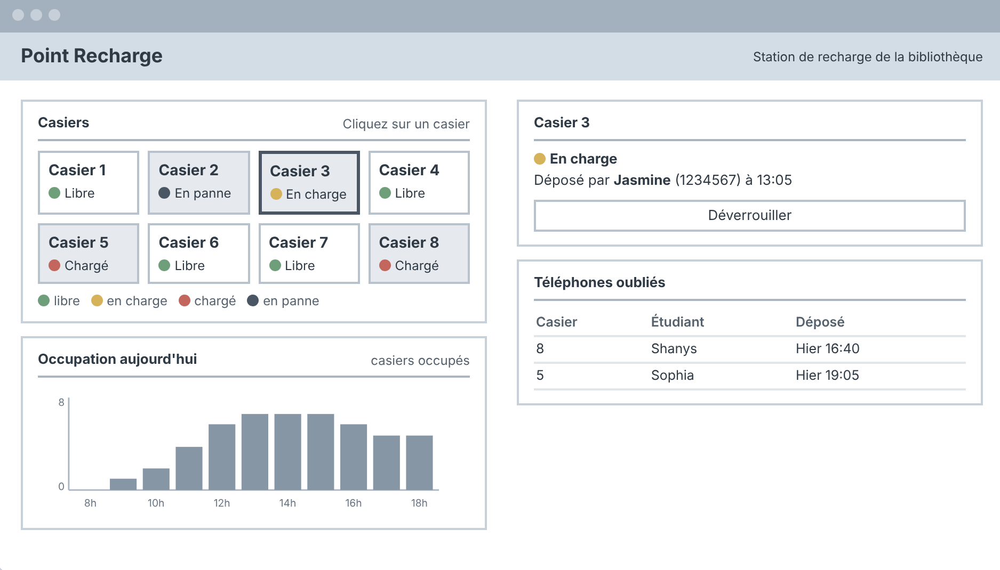

# Examen
- Durée prévue : environ 2 heures, mais vous disposez de toute la période de cours (3 heures). Si vous terminez plus tôt, vous pouvez travailler sur votre projet.
- La conversation avec l'intelligence artificielle est interdite.
- Faites une copie indépendante de ce projet (Use this template), donnez moi les droits d'accès en écriture et clonez votre projet.
- Remise sur classroom : 
    - Vous devez me remettre le lien de votre projet github dans classroom.
    - Vous devez obligatoirement faire une dernière remise avant votre départ.
- Il est recommandé de lire tout l'énoncé avant de commencer la modélisation.

## Base de données

Utilisez votre compte MongoDB Atlas et une base dédiée à l'examen, séparée de celle de votre projet.

Ajoutez les captures d'écran suivantes à déposer dans le dossier `images/` :
1. Votre utilisateur d'application et son rôle.
2. Une collection après l'insertion de quelques documents.

Assurez-vous de ne montrer aucune information sensible. 

## Mise en situation

La bibliothèque du cégep installe **Point Recharge**, une station de 8 casiers où les étudiants laissent leur cellulaire en recharge. Une seule station est installée pour le moment.

Chaque casier, numéroté de 1 à 8, a une prise de recharge, une serrure électrique, une DEL et un capteur de courant, tous branchés à un Raspberry Pi. Un casier est représenté par son numéro et son état : libre, en charge, chargé ou en panne.

Pour déposer son téléphone, l'étudiant entre son numéro et choisit un code à 4 chiffres sur le clavier de la station. Le Raspberry Pi verrouille le casier et enregistre le dépôt : l'étudiant, le casier, l'heure, et le code. Pour récupérer son téléphone, l'étudiant entre son code ; le Raspberry Pi déverrouille le casier et enregistre l'heure de la récupération. Les dépôts sont conservés après la récupération, pour garder l'historique.

Chaque étudiant est identifié par son numéro. Le personnel doit pouvoir voir le nom de l'étudiant qui a déposé un téléphone.

Le Raspberry Pi mesure le courant de chaque casier en continu et s'en sert pour changer l'état du casier (chargé quand la recharge est terminée, en panne si le câble est défectueux). Toutes les 15 minutes, il enregistre aussi le nombre de casiers occupés.

La maquette suivante montre l'interface utilisée par le personnel de la bibliothèque. Elle permet de :

- voir l'état des 8 casiers ;
- cliquer sur un casier pour voir quel étudiant y a déposé un téléphone, et à quelle heure ;
- voir l'occupation de la station ;
- voir les téléphones oubliés : ceux déposés avant aujourd'hui et pas encore récupérés ;
- déverrouiller un casier quand un étudiant a oublié son code ; le téléphone est alors considéré comme récupéré.

## Partie 1 - Modélisation
À partir de la mise en situation et de la maquette, complétez les collections et/ou les exemples de documents pour chaque collection.

Ajoutez une brève justification sous chaque exemple ou collection complétée.

## Partie 2 - Insertion des données
Complétez le code pour remplir la base avec des données de votre choix, conformes à votre modèle.

Il doit insérer au minimum :

- la station et ses 8 casiers, avec au moins un casier de chaque état ;
- 3 étudiants ;
- 16 lectures d'occupation, une aux 15 minutes pendant les 4 dernières heures ;
- 5 dépôts de téléphones par des étudiants :
  - 2 déposés aujourd'hui et pas encore récupérés ;
  - 2 déposés hier et pas encore récupérés (téléphones oubliés) ;
  - 1 déposé hier et déjà récupéré.

Les données doivent être cohérentes entre elles : chaque casier occupé correspond à un dépôt pas encore récupéré.

## Partie 3 - Requêtes
Écrivez chaque requête sur les données de la partie 2 et affichez correctement son résultat.

1. Les téléphones oubliés par ordre croissant de date de dépôt : les dépôts faits avant minuit (heure locale) et pas encore récupérés, avec le casier, le nom de l'étudiant et la date du dépôt.
2. Enregistrer le dépôt d'un téléphone par un étudiant (numéro étudiant, casier et code). Vous devez faire les vérifications nécessaires pour que le dépôt soit possible.